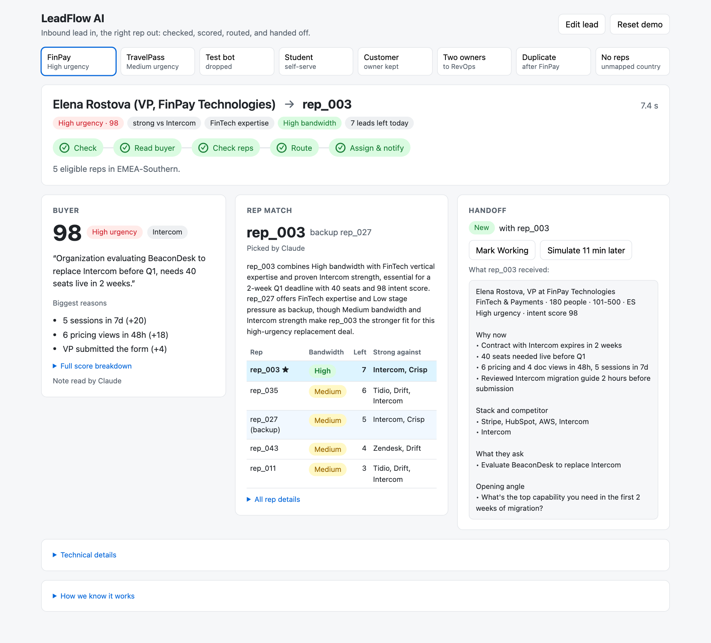

# LeadFlow-AI-Capstone
An autonomous multi-agent system to continuously evaluate live technographic and behavioral intent data, dynamically balance sales workloads, and instantly match high-intent prospects with the right sales reps.

## Demo

Short walkthrough of the inbound lead → triage → buyer/capacity → routing → assignment flow:

**[Watch the demo video](https://github.com/abhipill/LeadFlow-AI-Capstone/releases/download/demo-video/LeadFlowAI_demo.mp4)** ([release page](https://github.com/abhipill/LeadFlow-AI-Capstone/releases/tag/demo-video))

## How a lead flows

Every inbound form submission for BeaconDesk goes through cheap deterministic checks first. Only a new prospect with eligible reps reaches the two agents, which run in parallel: one reads the buyer, the other scores rep capacity. A routing agent then proposes the match, and code validates it before the assignment is committed.

The diagram below plays five example leads in a loop: a new prospect that reaches the agents, a test bot that is dropped, a student sent to self-serve, an existing customer whose owner is kept, and an account with two owners sent to RevOps. The step each lead is on is filled in blue, and the caption says what happens there. Every step is built and runs from `POST /leads`, and rounded labels are the `status` values the API returns.

<p align="center">
  
</p>

The diagram is generated by `docs/lead_flow_diagram.py`. Edit the stages, captions, or example leads there, then run `.venv/bin/python docs/lead_flow_diagram.py`.

## Status

| Flow stage | Status |
|---|---|
| Inbound submission (FastAPI) | Done |
| Required-field / schema validation | Done |
| Spam and noise filtering | Done (`leadflow/screening.py`) |
| Duplicate email/domain check | Done (`leadflow/screening.py`, `leadflow/store.py`) |
| Existing-account detection | Done (`leadflow/accounts.py`) |
| Existing account: preserve owner or raise exception | Done (`leadflow/accounts.py`, `leadflow/store.py`) |
| Filter eligible reps | Done (`leadflow/eligibility.py`) |
| Buyer agent (intent score and tier) | Done (`leadflow/buyer_agent.py`, Langflow flow in `flows/`). TheirStack and PostHog are mocked from the workbook. |
| Capacity service | Done (`leadflow/capacity.py`). Salesforce and calendar data are mocked from the workbook. |
| Routing agent | Done (`leadflow/routing.py`). Claude proposes; a rule-based ranker is the fallback. |
| Validate and commit | Done (`leadflow/commit.py`). Assignments are saved in SQLite and count toward each rep's load. |
| Rep handoff, lead status, and SLA watchdog | Done (`leadflow/handoff.py`). Messages go to a mock Slack outbox. |

`leadflow/pipeline.py` runs the deterministic stages in order with `triage()`, and `POST /leads` calls it for every valid submission. New prospects then go to the buyer agent and the capacity service, the routing agent proposes a primary and backup rep, the commit step assigns the lead, and the assigned rep is sent the brief.

## Triage order

A lead stops at the first stage that decides it.

1. **Screening.** Test, internal, and competitor addresses are dropped. Recruiting agencies, media and blogs, and companies of 1-15 people go to self-serve.
2. **Same-email duplicate.** The same address within the last 30 days is a `duplicate` and keeps the earlier lead's rep, if it had one.
3. **Existing account.** Preserve the owner, or raise an ownership exception.
4. **Rep-pool filter.** Shortlist eligible reps for a new prospect.

A same-domain duplicate does not stop the lead. The earlier submission and its rep are returned as `related_submission_id` and `related_rep_id`. Personal email domains such as `gmail.com` never count as a company match.

Every lead is written to the `submissions` table, which is what the duplicate check reads. Existing-account decisions are also appended to `routing_decisions`.

Free-text notes are not screened. Words like "student" appear in valid notes (an EdTech buyer's student support spike), so notes are left to the buyer agent.

## Agent contracts

`leadflow/contracts.py` fixes what the agents receive and return, so they can be built separately and plugged into triage. Each output is a Pydantic model. Validate an LLM response with `Model.model_validate_json(text)`, or pass `Model.model_json_schema()` to a structured-output API. Each model has a worked example for the FinPay lead (`sub_8f92a1c4`).

| Component | Receives | Returns |
|---|---|---|
| Buyer agent | The `Lead` only, never rep data | `BuyerAssessment`: `intent_score` 1-100, `urgency_tier`, `detected_competitor`, `buying_signals`, `note_summary`, `rationale`, the TheirStack `firmographics` and PostHog `behavior` it used, and `tool_status` per tool |
| Capacity service | The `EligibleReps` shortlist, the roster, and the prospect's domain, never buyer intent | `CapacityMatrix`: one `RepCapacity` row per shortlisted rep with bandwidth tier, stage pressure, pipeline, backlog, meeting load, vertical expertise, and competitor strengths |
| Routing agent | The lead, both outputs above, and the shortlist | `RoutingProposal`: `primary_rep_id`, `backup_rep_id`, `routing_rationale`, `rep_brief` |

Tiers are `High`, `Medium`, or `Low`, matching the workbook. Competitors are `Intercom`, `Zendesk`, `Drift`, `Crisp`, or `Tidio`. `tool_status` is `ok`, `mocked`, `timeout`, `error`, or `skipped`, which is what the fallback-rate eval counts.

Two checks run before anything is committed:

- `check_capacity` requires the matrix to cover exactly the shortlisted reps.
- `check_proposal` requires both reps to be on the shortlist and different. A backup is required whenever the shortlist has more than one rep.

Each returns a list of problems, empty when the output is usable. `StepTiming` records how long each stage took and whether it timed out or fell back, for the latency evals and the demo.

## Buyer agent

The LLM reads the note; rules compute the score. Claude extracts what the free-text note states (`NoteSignals`: deadline, seats, competitor named, compliance needs, buying stage, pain points, a one-line summary) through a forced tool call, so the reply always fits the schema. `leadflow/scoring.py` then adds up points from those signals, the form, and PostHog behavior. The same signals always give the same score, and every point is listed in `score_breakdown`, which is what a rep (or the demo) sees as the reason.

The agent's steps depend on what it finds:

- A personal email, or a domain TheirStack does not know, is looked up by company name instead.
- No note skips the LLM. No API key, or a failed call, falls back to rule extraction, and `tool_status["llm"]` records `skipped` or `error`.
- PostHog with no data for the lead scores behavior at a neutral default rather than zero, and says so in the breakdown.
- A note that names one competitor while TheirStack detects another is flagged in `buying_signals`.

| Rubric line | Points |
|---|---|
| Base (valid inbound lead) | 44 |
| Role | CXO 6, VP 4, Director 2, Manager and Contributor 0 |
| Inquiry reason | Buy 3, compliance 2, evaluate 1, plan 0 |
| Pricing views (48h) | 3 each, up to 6 views |
| Doc views (48h) | 1 each, up to 5 views |
| Sessions (7d) | 4 each, up to 5 sessions |
| Deadline within 30 days, or "immediately" | 3 |
| 10 or more seats | 2 |
| Competitor named in the note | 2 |
| Any compliance requirement | 7 |
| Says they are ready to buy | 2 |

The score is capped at 1-100. 80 and above is High, 40 to 79 is Medium, below 40 is Low. The weights were tuned on the 15 workbook leads with an expected score, where behavior carries most of the weight because that is what the expected scores track. The workbook has no Low leads, so the Low cutoff is a team assumption.

Run buyer evals with `.venv/bin/python -m leadflow.eval_buyer` (rules) or `--llm` (Claude, needs `ANTHROPIC_API_KEY`); add `--repeat 3` for replay consistency. With rule extraction, all 15 leads land in their expected tier, with no critical errors and a mean score error of 3 points. `data/buyer_signals_gold.json` holds hand-labelled signals for the same leads, used to check extraction accuracy. Three leads (CloudScale, PayFlow, DevStack) score exactly 80, so an extraction miss on those drops them to Medium.

Routing and capacity have matching harnesses (same 15 shortlists):

```bash
.venv/bin/python -m leadflow.eval_routing          # ranker offline; add --llm for Claude
.venv/bin/python -m leadflow.eval_capacity         # contract checks (no LLM)
```

Routing scores against `data/routing_gold.json` (10 hand-labeled primaries/backups). Capacity checks contracts and `data/capacity_bandwidth_gold.json` (12 labeled lead×rep bandwidth tiers). Buyer holdout: `python -m leadflow.eval_buyer --holdout`. Failure modes: `python -m leadflow.eval_failure_modes`.

#### Arize Phoenix (quality traces)

The **labels / baselines used for eval** live in this repo (anyone who clones gets them):

| File / source | What it is |
|---------------|------------|
| `data/LeadFlow AI mock dataset.xlsx` | 15 leads with expected intent score and urgency tier |
| `data/buyer_signals_gold.json` | Hand-labelled note signals for those leads |
| Ranker order (code) | Consistency baseline for routing — not a labeled correct rep |
| Shortlist + `check_capacity` | Contract expected for capacity |
| `data/capacity_bandwidth_gold.json` | Hand-reviewed High/Medium/Low bandwidth for 12 lead×rep pairs |

`leadflow/eval_buyer.py`, `eval_routing.py`, and `eval_capacity.py` print metrics in the terminal. That is the source of truth.

**Phoenix Datasets are different.** Arize Phoenix is a local web app (http://127.0.0.1:6006). A “Dataset” there is just a copy of the same inputs/baselines, uploaded into Phoenix’s own database so the UI can show tables and run experiments. That upload is **not** stored in GitHub. Cloning the repo does **not** put rows under Phoenix → Datasets until you run the commands below on your machine (or point at a shared hosted Phoenix).

```bash
.venv/bin/pip install -r requirements-observability.txt
.venv/bin/phoenix serve   # UI at http://127.0.0.1:6006; leave this running
.venv/bin/python -m leadflow.eval_buyer --llm --phoenix
.venv/bin/python -m leadflow.eval_routing --llm --phoenix
.venv/bin/python -m leadflow.eval_capacity --phoenix
```

| Command | Phoenix dataset | Experiment (UI) | Project traces |
|---------|-----------------|-----------------|----------------|
| `eval_buyer [--llm] --phoenix` | `leadflow-buyer-workbook` | `buyer-rules` / `buyer-llm` | `leadflow-buyer-eval` |
| `eval_routing [--llm] --phoenix` | `leadflow-routing-workbook` | `routing-ranker` / `routing-llm` | `leadflow-routing-eval` |
| `eval_capacity --phoenix` | `leadflow-capacity-workbook` | `capacity-contract` | `leadflow-capacity-eval` |
| `eval_components [--phoenix]` | `leadflow-buyer-workbook` | component experiment | (scores recorded on the dataset) |

Each `--phoenix` run creates/reuses the dataset, logs span annotations, and calls Phoenix `experiments.run_experiment` so results appear under **Datasets → (dataset) → Experiments** (not only under Projects).

Collaborators: pull the repo, start Phoenix, run the `--phoenix` commands once. They rebuild datasets from the same committed files; they do not need your laptop’s Phoenix DB.

For live API traces during the demo, set `LEADFLOW_PHOENIX=1` (and optionally `PHOENIX_COLLECTOR_ENDPOINT` / `PHOENIX_API_KEY` for hosted Phoenix). Each lead sent to `POST /leads` then shows up in **Projects → `leadflow-api`** as one trace:

```
lead                      the submitted lead in, status and assigned rep out
├── triage                outcome and reason
├── buyer_agent           BuyerAssessment
│   └── messages.create   Claude note extraction: prompt, tool call, tokens, latency
├── capacity_service      CapacityMatrix
├── routing_agent         RoutingOutcome
│   └── messages.create   Claude routing proposal and brief
└── commit                Assignment
```

A failed stage shows as an error span, so a routing timeout that fell back to the ranker is easy to find, and the tree shows where a lead's time goes (routing takes most of it).

#### Component evals

`leadflow/eval_components.py` scores the two Claude calls on the same 15 leads, running the real pipeline up to the routing proposal (nothing is committed):

| Component | Evaluator | Type | What it checks |
|---|---|---|---|
| Note extraction | `field_accuracy` | Code | Deadline, seats, competitor, compliance, and buying stage equal the hand labels exactly (stricter than `eval_buyer`, which compares at the scorer's granularity) |
| Note extraction | `summary_faithfulness` | LLM judge | Every fact in the summary is in the inquiry reason or the note, with no two facts merged |
| Note extraction | `tier_accuracy` | Code | The scored tier equals the workbook's expected tier |
| Rep brief | `brief_quality` | LLM judge | 1–5 rubrics: tone, facts from the note, usable as-is |
| Rep choice | `rule_compliance` | Code | No High-urgency lead on a Low-bandwidth rep when another fits, no available related rep skipped, a distinct backup |
| Rep choice | `counterfactual_sensitivity` | Code | Once the chosen rep is made unable to take the lead, Claude picks someone else (one extra routing call) |
| Rep brief | `brief_completeness` | Code | Every extracted signal is in the brief, numbers and timeframes copied exactly |
| Rep brief | `brief_format` | Code | Plain text, under 120 words, bullets of 15 words at most, no gendered pronouns, after-hours line when due |
| Rep brief | `brief_faithfulness` | LLM judge | Every claim is in the routing input, with no invented fact, meeting, or next step |

The judge is Claude Opus 5.5 (`LEADFLOW_JUDGE_MODEL` to change it) and returns the unsupported claims it found. It has not been calibrated against hand labels yet. Checks that do not apply, such as rule compliance when the ranker made the proposal, are left unscored.

```bash
.venv/bin/python -m leadflow.eval_components             # prints failures and averages
.venv/bin/python -m leadflow.eval_components --phoenix   # also records the run as a Phoenix experiment
.venv/bin/python -m leadflow.eval_components --limit 2 --no-judge   # quick check
```

With `--phoenix`, the run becomes an experiment on the `leadflow-buyer-workbook` dataset (created if missing), with a score, label, and explanation per lead and evaluator, so runs can be compared after a prompt or model change. Scores are computed locally in parallel and then recorded, so a full run takes a few minutes.

### Langflow

The same agent runs as a Langflow flow: Parse Lead, then Buyer Enrichment and Note Signals (Claude) side by side, then Buyer Score. The components in `flows/components/leadflow/` are thin wrappers around the `leadflow` package, so the API and Langflow score identically.

<p align="center">
  
</p>

Langflow needs Python 3.10+, so it gets its own environment:

```bash
uv venv .venv-langflow --python 3.13
uv pip install --python .venv-langflow/bin/python langflow -e .
```

Run the flow once from the command line:

```bash
.venv-langflow/bin/lfx run flows/buyer_agent_flow.py --input-value "$(cat flows/sample_lead.json)"
```

Or open it in the editor: start Langflow, then import `flows/buyer_agent.json` (or drag the file onto the canvas) and paste a lead's JSON into the Playground.

```bash
LANGFLOW_AUTO_LOGIN=true .venv-langflow/bin/langflow run --components-path flows/components
```

`flows/buyer_agent_flow.py` defines the graph. After changing it, regenerate the JSON with `.venv-langflow/bin/python flows/buyer_agent_flow.py`.

## Capacity service

`CapacityService` turns the shortlist into a `CapacityMatrix` with one `RepCapacity` row per rep, in shortlist order. It is plain Python: no LLM call. It never sees buyer intent. The dimensions are kept separate rather than combined into one rank, so the routing agent can weigh them against the buyer.

**Stage pressure** comes from late-stage deals (Proposal plus Negotiation): 0-3 is Low, 4-5 is Medium, 6 or more is High.

**Bandwidth tier** counts load flags: none is High, one is Medium, two or more is Low.

| Flag | Raised when |
|---|---|
| Daily cap | 3 or fewer leads left under today's cap |
| Backlog | Overdue tasks plus unworked leads is 4 or more |
| Meetings | 5 or more hours of meetings today |
| Weekly load | 400 or more intent points already routed this week |
| Pipeline | 16 or more open opportunities |

Stage pressure is not a bandwidth flag, so a rep can be High bandwidth with High stage pressure. On the 50-rep roster this gives 16 High, 20 Medium, and 14 Low bandwidth reps. The thresholds are team assumptions; the workbook has no expected capacity values.

Each row also carries the raw counts (open opps, pipeline ARR, overdue tasks, unworked leads, leads left today, meeting hours, back-to-back calls), the rep's vertical expertise, and `competitor_strengths` parsed from the workbook's win-rate affinity column. `notes` lists the flags that were raised, and adds a line when the rep previously lost a deal on the prospect's domain (a Closed Lost row in `data/mock_accounts.csv`).

## Routing agent

`RoutingAgent` picks a primary and a backup rep from the shortlist. It sees the lead, the `BuyerAssessment`, the `CapacityMatrix`, the shortlist, and the rep of an earlier lead from the same company domain, if there was one. It only proposes; nothing is assigned.

1. Claude (`claude-haiku-4-5` by default, `LEADFLOW_ROUTING_MODEL` to change) returns the proposal as structured output. The JSON schema only allows rep IDs from the shortlist. Claude also writes `routing_rationale` and a `rep_brief` for the primary rep.
2. `check_proposal` runs on the result: both reps on the shortlist, different, and a backup whenever the shortlist has more than one rep.
3. If there is no API key, the call fails or times out, or the check fails, the ranker makes the proposal instead, with a template rationale and brief. `method` says which one was used, `llm_status` says why, and `problems` lists any check failures.

The ranker sorts the shortlist by, in order:

| # | Rule |
|---|---|
| 1 | For a High-urgency lead, Low-bandwidth reps go last |
| 2 | The rep of an earlier lead from the same company domain |
| 3 | Strong against the buyer's competitor |
| 4 | Vertical expertise shares a word with the buyer's industry |
| 5 | Bandwidth tier, High first |
| 6 | Stage pressure, Low first |
| 7 | Leads left today, most first |
| 8 | `rep_id`, so ties resolve the same way every time |

On the 15 workbook leads, Claude's proposals all passed the check, and its primary matched the ranker's first choice on 13. In the other two it chose a rep with more time over a closer vertical match (PropTech) or lower stage pressure (Nexus Cloud). The workbook has no expected rep per lead, so this measures consistency, not accuracy.

With the sectioned brief, a routing call takes about 8 seconds (median over 12 workbook leads), and the slowest calls come close to the 10-second timeout; a call that runs over falls back to the ranker. Most of the time goes to Claude's thinking, about 1,900 output tokens against about 250 for the visible reply. Turning thinking off brought the call down to about 3 seconds in testing, but made the choice between close candidates slightly weaker, so thinking stays on.

## Validate and commit

`commit_assignment` turns the routing proposal into an assignment. The workbook's rep counts are a fixed snapshot, so live load is the workbook baseline plus the assignments committed since: leads per rep for the lead's day (the UTC date of `submitted_at`) and intent points per rep for its ISO week. The rep filter, the capacity service, and the commit step all read live load, so each assignment changes how the next lead is filtered and scored.

The commit runs in one SQLite transaction that holds the database lock from its first read:

1. If the submission was already committed, the earlier assignment is returned unchanged (`already_committed`).
2. Candidates are the proposal's primary and backup, if the proposal still passes `check_proposal`, then the rest of the ranker's order.
3. A candidate is skipped if it is not on the shortlist or the roster, not Active, or at the daily cap under the live count. `skipped` lists each one with the reason.
4. The first free candidate gets the lead and the next free one is kept as the backup for the SLA watchdog. If no candidate is free, the outcome is `revops_queue`.
5. The assignment is saved, and the submission's assigned rep is set, so a later duplicate returns it.

Because the lock is taken before the counts are read, two leads cannot both take a rep's last slot. A test runs six commits at once against two reps with one slot each and checks that exactly two are assigned.

The existing-account path is not counted toward a rep's daily cap: the owner keeps the account whatever their load.

## Rep handoff, status, and SLA watchdog

**Handoff.** After a commit, the assigned rep gets a message in the mock Slack outbox (the `handoffs` table): the routing brief, why they were picked, the backup, and their time limit. A lead with no free rep goes to RevOps. An existing account's owner gets the ownership brief, and an ownership exception goes to RevOps. Each message is sent once per lead, so re-sending a lead does not repeat it.

**Status.** An assigned lead starts at New. The rep moves it to Working, then to Converted or Disqualified. Other moves return `409`. Every change is saved in `status_events` with the time, the status, who made it (`system`, `rep`, or `watchdog`), and a note.

**SLA watchdog.** `run_watchdog` checks assigned leads still at New:

| Urgency | Time limit | When the limit passes |
|---|---|---|
| High | 10 minutes | Reassigned to the backup rep, once. If the backup is no longer Active or under the live daily cap, or the lead stalls again, it is escalated to RevOps |
| Medium | 60 minutes | Reported as overdue, no change |
| Low | 4 hours | Reported as overdue, no change |

The clock restarts at each reassignment. A reassignment moves the lead's daily count from the first rep to the backup, so the first rep gets the slot back. Both reps, and RevOps on escalation, get a message. The spec sets 5 to 10 minutes for High urgency; the Medium and Low limits are team assumptions.

The watchdog runs when `POST /watchdog/run` is called, not on a timer. `minutes_ahead` pretends that time has passed, so the demo can show a reassignment without waiting; the events it writes are stamped with that pretend time. On the demo page, send FinPay and click **Simulate 11 min later**: the lead moves from rep_003 to rep_027 and both reps get a message. Click **Simulate another 11 min** and it is escalated to RevOps. Mark the lead Working first and the watchdog leaves it alone.

## Setup

Requires Python 3.9+.

```bash
python3 -m venv .venv
.venv/bin/pip install -r requirements.txt
cp .env.example .env   # then add your ANTHROPIC_API_KEY
```

`.env` is gitignored. Without a key, the buyer agent uses rule extraction and the routing agent uses the ranker.

## Running the API

```bash
.venv/bin/uvicorn leadflow.api:app --reload
```

The demo page is at http://127.0.0.1:8000/. Click one of the eight scenario buttons (two new prospects, a test bot, a student, an existing customer, two account owners, a duplicate, and an unmapped country) to send that lead. The page leads with the outcome in one line (who the lead is, which rep got it, and why), shows the five steps with the one that decided the lead, and then three cards: **Buyer** (score, note summary, biggest reasons), **Rep match** (chosen rep and backup, Claude's rationale, a compact comparison of the shortlisted reps), and **Handoff** (status, Mark Working, Simulate 11 min later, and the brief the rep received). Score breakdowns, full rep details, and the raw JSON response are one click away. **Edit lead** opens the full form, with all 26 sample leads, for trying your own; **Reset demo** clears assignments, messages, and status history. A link such as `http://127.0.0.1:8000/#send=sub_8f92a1c4` picks that sample and sends it straight away, which is handy for a short live demo (Demo Day allows about 1–2 minutes for a working implementation).

For poster metrics without the UI, `GET /demo/eval-summary` returns workbook buyer, routing (ranker), and capacity numbers (same as the three `eval_*` modules offline).

<p align="center">
  
</p>

The screenshot shows the FinPay lead (`sub_8f92a1c4`) with Claude reading the note and proposing the route: assigned to rep_003 with backup rep_027, the brief sent, and the lead at New until the rep marks it Working. The request took about 7 seconds end to end.

Interactive API docs are at http://127.0.0.1:8000/docs. The `POST /leads` form there is pre-filled with a valid example lead.

| Endpoint | Behaviour |
|---|---|
| `GET /` | Demo page |
| `GET /demo/samples` | Sample leads for the demo page |
| `GET /demo/eval-summary` | Workbook buyer gold metrics for posters / quick quality checks |
| `GET /health` | Returns `{"status": "ok"}` |
| `POST /leads` | Validates, triages, routes, and commits a form submission. Returns `202` with the triage outcome as `status`, or `422` with a per-field error list. |
| `GET /leads/{submission_id}/tracking` | The lead's assignment, status history, and messages sent about it |
| `POST /leads/{submission_id}/status` | Moves an assigned lead on, e.g. `{"status": "Working"}`. `404` if it has no assignment, `409` if the move is not allowed |
| `POST /watchdog/run?minutes_ahead=0` | Runs the SLA watchdog; `minutes_ahead` pretends that much time has passed |
| `GET /outbox` | The latest messages in the mock Slack outbox |
| `POST /demo/reset` | Deletes assignments, messages, and status history, so reps are back to the workbook's load |

A `202` response has these fields:

| Field | Contents |
|---|---|
| `status` | `dropped`, `self_serve`, `duplicate`, `preserve_owner`, `ownership_exception`, `new_prospect`, or `no_eligible_reps` |
| `reason` | One sentence explaining the outcome |
| `assigned_rep_id` | The committed rep for a new prospect, the kept owner for an existing account, or the earlier lead's rep for a duplicate; otherwise null |
| `lead` | The normalised lead |
| `triage` | The full result: `ownership` with the handoff brief, or `shortlist` with eligible and excluded reps, plus duplicate links |
| `buyer` | For `new_prospect` only: the `BuyerAssessment` with score, tier, signals, and `score_breakdown`; otherwise null |
| `capacity` | For `new_prospect` only: the `CapacityMatrix`, one row per shortlisted rep; otherwise null |
| `routing` | For `new_prospect` only: the `RoutingOutcome`, with the `RoutingProposal`, whether Claude or the ranker made it, and the ranker's order; otherwise null |
| `assignment` | For `new_prospect` only: the committed `Assignment`, with the rep, backup, any skipped candidates and why, and whether it was committed earlier; otherwise null |
| `tracking` | For new prospects and existing accounts: the `LeadTracking`, with status, status history, and the messages sent; otherwise null |

Submissions and assignments are recorded in `data/leadflow.db`. Delete that file to start over; otherwise resending the same email within 30 days returns `duplicate`. To clear only the assignments, messages, and status history, use the demo page's Reset demo button or `POST /demo/reset`.

Example:

```bash
curl -X POST http://127.0.0.1:8000/leads \
  -H "Content-Type: application/json" \
  -d '{
    "first_name": "Elena",
    "last_name": "Rostova",
    "work_email": "elena@finpay.es",
    "role": "VP",
    "country": "ES",
    "state": null,
    "company": "FinPay Technologies",
    "company_size": "101-500",
    "phone_number": "+34915550199",
    "inquiry_reason": "I want to evaluate BeaconDesk for my organization",
    "free_text_note": "Our contract with Intercom expires in 2 weeks."
  }'
```

## Running the tests

```bash
.venv/bin/python -m pytest -q
```

## Project layout

```
data/LeadFlow AI mock dataset.xlsx   Mock form submissions, expected outcomes, and rep roster
data/mock_accounts.csv               Mock CRM accounts for the existing-account gate
data/territories.csv                 Territory and language by country, and by state for the US
data/buyer_signals_gold.json         Hand-labelled note signals for checking extraction
data/routing_gold.json               Hand-labelled expected primary/backup for 10 leads
data/buyer_holdout.json              Three leads for the buyer --holdout slice
data/failure_modes.json              Five edge-case scenarios with expected behavior
leadflow/models.py                   Shared record types
leadflow/contracts.py                Agent inputs and outputs
leadflow/data_loader.py              Loads the Excel dataset (including enrichment columns), account table, and territory file
leadflow/enrichment.py               Mock TheirStack and PostHog lookups
leadflow/extraction.py               Note signals: Claude, with a rules fallback
leadflow/scoring.py                  Rule-based intent score and tier
leadflow/buyer_agent.py              Buyer agent: enrich, extract, score
leadflow/eval_buyer.py               Buyer agent evals against the workbook
leadflow/eval_routing.py             Routing evals: proposal validity + Claude↔ranker consistency
leadflow/eval_capacity.py            Capacity evals: check_capacity + shortlist coverage
leadflow/eval_components.py          Component evals of the Claude calls (extraction, routing, brief), optional Phoenix experiment
leadflow/eval_failure_modes.py       Five failure-mode / edge scenarios
leadflow/phoenix_experiments.py      Shared Phoenix experiment helpers for eval_* --phoenix runs
leadflow/observability.py            Optional Arize Phoenix tracing (LEADFLOW_PHOENIX / --phoenix), one trace per lead
leadflow/capacity.py                 Capacity service: bandwidth, stage pressure, and fit per shortlisted rep
leadflow/routing.py                  Routing agent: Claude proposal, shortlist check, ranker fallback
leadflow/commit.py                   Validate and commit: live rep load, locked assignment, RevOps queue
leadflow/handoff.py                  Rep handoff messages, lead status, SLA watchdog
leadflow/screening.py                Spam, noise, non-ICP, and duplicate checks
leadflow/accounts.py                 Domain match, preserve owner or raise exception, handoff brief
leadflow/eligibility.py              Rep-pool filter for new prospects
leadflow/pipeline.py                 triage(): the deterministic stages in order
leadflow/store.py                    SQLite submissions and decisions (data/leadflow.db, not committed)
leadflow/api.py                      FastAPI app
leadflow/demo.py                     Sample leads for the demo page
leadflow/static/index.html           Demo page (plain HTML and JavaScript, no build step)
tests/test_data_loader.py            Dataset loading and cleaning
tests/test_screening.py              Screening and duplicate rules
tests/test_accounts.py               Account matching
tests/test_existing_account.py       Owner decision, brief, and persistence
tests/test_eligibility.py            Territories and rep-pool filter rules
tests/test_pipeline.py               End-to-end triage
tests/test_buyer_agent.py            Enrichment, extraction, scoring, agent fallbacks, evals
tests/test_capacity.py               Capacity tiers, flags, competitor strengths, closed-lost history
tests/test_routing.py                Ranker order, fallbacks, Claude request shape
tests/test_commit.py                 Assignment order, daily cap, idempotency, concurrent commits
tests/test_handoff.py                Handoff messages, status moves, watchdog reassignment and escalation
tests/test_demo.py                   Demo page, samples, and scenario paths
tests/test_api.py                    Endpoint and validation rules
tests/test_observability.py          Trace per lead with a span per stage, no-op when tracing is off
tests/test_eval_components.py        Component evaluators and judge parsing, offline
flows/buyer_agent_flow.py            Buyer agent as a Langflow graph; exports flows/buyer_agent.json
flows/components/leadflow/           Langflow components wrapping the buyer agent steps
```

## Existing-account path

`resolve_existing_account` matches the lead's email domain against the active accounts and returns `None` for a new prospect. One owner on the roster is preserved and becomes `assigned_rep_id`. Two owners, an active record with no owner, or an owner missing from the roster becomes an `ownership_exception` for RevOps, with the candidate owners listed. Both outcomes include a plain-text handoff brief. `DecisionStore.save` appends the decision to the `routing_decisions` table. The buyer agent and the routing agent are not called on this path.

## Rep-pool filter

`filter_eligible_reps` runs only for new prospects. A rep must cover the lead's territory, then pass these rules in order. The first failure is recorded in `excluded`.

| Rule | Lead side | Rep side |
|---|---|---|
| Territory | `data/territories.csv`: US by state (Pacific and Mountain states are NA-West), other countries by country code | `territory` |
| Segment | 1-15 and 16-100 are SMB; 51-250 to 1000 are Mid-Market; 1001+ is Enterprise | `segments` |
| Language | The territory row's language: local for Spanish, Portuguese, French, German, Japanese and Chinese speaking countries, English elsewhere | `languages` |
| Availability | — | `working_status` is `Active` |
| Daily cap | — | `leads_assigned_today` below `daily_lead_cap` |
| Working hours | `submitted_at` | Weekday, 09:00 to 18:00 in the rep's `timezone` |

At most six reps are kept, those with the most cap headroom first, then by `rep_id`. A country not in the territory file gets an empty shortlist and the outcome `no_eligible_reps`.

If every rep that passed the other rules is outside working hours, they are shortlisted anyway with `after_hours` set, so a lead that arrives at night is still routed. Every rep in a territory shares one timezone in the mock roster, so working hours currently flag a lead rather than narrow its shortlist. Seven of the 15 workbook leads arrive after hours.

## Validation rules

Applied by the `Lead` model, so API submissions and dataset rows are checked the same way.

| Field | Rule |
|---|---|
| `submission_id` | Generated as `sub_<8 hex chars>` if omitted |
| `submitted_at` | `YYYY-MM-DDTHH:MM:SSZ`; set to the current UTC time if omitted |
| `first_name`, `last_name`, `company` | Non-empty after trimming whitespace |
| `work_email` | Must match `user@domain.tld`; lowercased |
| `role` | `CXO`, `VP`, `Director`, `Manager`, `Contributor` |
| `country` | 2-letter code; uppercased |
| `state` | Required USPS code when `country` is `US`; must be null otherwise |
| `company_size` | `1-15`, `16-100`, `51-250`, `101-500`, `251-1000`, `501-1000`, `1001+` |
| `phone_number` | 8–15 digits; normalised to `+<digits>` |
| `inquiry_reason` | One of the four form dropdown values |
| `free_text_note` | Optional, max 5,000 characters; blank becomes null |

## Dataset notes

The loader reads two sheets: `Mock dataset - Buyer Context br` (20 leads, 5 expected to be excluded) and `Mock dataset - CRM & Rep Calend` (50 reps). It corrects these issues:

- **Company size stored as a date.** Excel converted `1-15` to `2026-01-15` on all five excluded leads. The loader converts dates back to `month-day`.
- **Phone numbers stored as numbers.** They have no leading `+`. The `Lead` model normalises them.
- **Empty cells.** Converted to `None` rather than NaN.

Choices that depart from the form schema:

- `51-250` and `251-1000` are accepted as company sizes. The schema does not list them, but valid leads in the dataset use them.
- The email check is a format check only. Domains such as `.local` pass validation. Screening does not drop `.local` either, because the workbook sends that lead (`mariasbakery.local`) to self-serve on company size.

Other things to know about the data:

- Existing-account rows live in `data/mock_accounts.csv`, not in the workbook. None of those domains are used by the 20 form submissions, so the labeled flow paths stay valid. Matching is exact on the email domain. A Customer or Open Opportunity with one owner preserves that owner. Two owners, or an active row with no owner, is an ambiguous-ownership exception. A Closed Lost row does not count as an existing account.
- Several rep names are shared with lead names, and two rep names appear twice under different IDs. Code identifies reps by `rep_id` only.
