# LeadFlow-AI-Capstone
An autonomous multi-agent system to continuously evaluate live technographic and behavioral intent data, dynamically balance sales workloads, and instantly match high-intent prospects with the right sales reps.

## How a lead flows

Every inbound form submission for BeaconDesk goes through cheap deterministic checks first. Only a new prospect with eligible reps reaches the two agents, which run in parallel: one reads the buyer, the other scores rep capacity. A routing agent then proposes the match, and code validates it before the assignment is committed.

The diagram below plays five example leads in a loop: a new prospect that reaches the agents, a test bot that is dropped, a student sent to self-serve, an existing customer whose owner is kept, and an account with two owners sent to RevOps. The step each lead is on is filled in blue, and the caption says what happens there. Green steps are built and run from `POST /leads`, dashed steps are planned, and rounded labels are the `status` values the API returns.

<p align="center">
  
</p>

The diagram is generated by `docs/lead_flow_diagram.py`. Edit the stages, captions, or example leads there, then run `.venv/bin/python docs/lead_flow_diagram.py`.

## Status

| Flow stage | Status |
|---|---|
| Inbound submission (FastAPI) | Done |
| Required-field / schema validation | Done |
| Spam and noise filtering | Done (`leadflow/screening.py`) |
| Duplicate email/domain check | Done (`leadflow/screening.py`, `leadflow/store.py`) |
| Existing-account detection | Done (`leadflow/accounts.py`) |
| Existing account: preserve owner or raise exception | Done (`leadflow/accounts.py`, `leadflow/store.py`) |
| Filter eligible reps | Done (`leadflow/eligibility.py`) |

`leadflow/pipeline.py` runs these stages in order with `triage()`, and `POST /leads` calls it for every valid submission.

## Triage order

A lead stops at the first stage that decides it.

1. **Screening.** Test, internal, and competitor addresses are dropped. Recruiting agencies, media and blogs, and companies of 1-15 people go to self-serve.
2. **Same-email duplicate.** The same address within the last 30 days is a `duplicate` and keeps the earlier lead's rep, if it had one.
3. **Existing account.** Preserve the owner, or raise an ownership exception.
4. **Rep-pool filter.** Shortlist eligible reps for a new prospect.

A same-domain duplicate does not stop the lead. The earlier submission and its rep are returned as `related_submission_id` and `related_rep_id`. Personal email domains such as `gmail.com` never count as a company match.

Every lead is written to the `submissions` table, which is what the duplicate check reads. Existing-account decisions are also appended to `routing_decisions`.

Free-text notes are not screened. Words like "student" appear in valid notes (an EdTech buyer's student support spike), so notes are left to the buyer agent.

## Setup

Requires Python 3.9+.

```bash
python3 -m venv .venv
.venv/bin/pip install -r requirements.txt
```

## Running the API

```bash
.venv/bin/uvicorn leadflow.api:app --reload
```

Interactive docs are at http://127.0.0.1:8000/docs. The `POST /leads` form there is pre-filled with a valid example lead.

| Endpoint | Behaviour |
|---|---|
| `GET /health` | Returns `{"status": "ok"}` |
| `POST /leads` | Validates and triages a form submission. Returns `202` with the triage outcome as `status`, or `422` with a per-field error list. |

A `202` response has these fields:

| Field | Contents |
|---|---|
| `status` | `dropped`, `self_serve`, `duplicate`, `preserve_owner`, `ownership_exception`, `new_prospect`, or `no_eligible_reps` |
| `reason` | One sentence explaining the outcome |
| `assigned_rep_id` | The kept owner, or the earlier lead's rep for a duplicate; otherwise null |
| `lead` | The normalised lead |
| `triage` | The full result: `ownership` with the handoff brief, or `shortlist` with eligible and excluded reps, plus duplicate links |

Submissions are recorded in `data/leadflow.db`. Delete that file to start over; otherwise resending the same email within 30 days returns `duplicate`.

Example:

```bash
curl -X POST http://127.0.0.1:8000/leads \
  -H "Content-Type: application/json" \
  -d '{
    "first_name": "Elena",
    "last_name": "Rostova",
    "work_email": "elena@finpay.es",
    "role": "VP",
    "country": "ES",
    "state": null,
    "company": "FinPay Technologies",
    "company_size": "101-500",
    "phone_number": "+34915550199",
    "inquiry_reason": "I want to evaluate BeaconDesk for my organization",
    "free_text_note": "Our contract with Intercom expires in 2 weeks."
  }'
```

## Running the tests

```bash
.venv/bin/python -m pytest -q
```

## Project layout

```
data/LeadFlow AI mock dataset.xlsx   Mock form submissions, expected outcomes, and rep roster
data/mock_accounts.csv               Mock CRM accounts for the existing-account gate
data/territories.csv                 Territory and language by country, and by state for the US
leadflow/models.py                   Shared record types
leadflow/data_loader.py              Loads the Excel dataset, account table, and territory file
leadflow/screening.py                Spam, noise, non-ICP, and duplicate checks
leadflow/accounts.py                 Domain match, preserve owner or raise exception, handoff brief
leadflow/eligibility.py              Rep-pool filter for new prospects
leadflow/pipeline.py                 triage(): the deterministic stages in order
leadflow/store.py                    SQLite submissions and decisions (data/leadflow.db, not committed)
leadflow/api.py                      FastAPI app
tests/test_data_loader.py            Dataset loading and cleaning
tests/test_screening.py              Screening and duplicate rules
tests/test_accounts.py               Account matching
tests/test_existing_account.py       Owner decision, brief, and persistence
tests/test_eligibility.py            Territories and rep-pool filter rules
tests/test_pipeline.py               End-to-end triage
tests/test_api.py                    Endpoint and validation rules
```

## Existing-account path

`resolve_existing_account` takes a lead whose domain matched an active account. One owner on the roster is preserved and becomes `assigned_rep_id`. Two owners, an active record with no owner, or an owner missing from the roster becomes an `ownership_exception` for RevOps, with the candidate owners listed. Both outcomes include a plain-text handoff brief. `DecisionStore.save` appends the decision to the `routing_decisions` table. The buyer agent and the routing agent are not called on this path.

## Rep-pool filter

`filter_eligible_reps` runs only for new prospects. A rep must cover the lead's territory, then pass these rules in order. The first failure is recorded in `excluded`.

| Rule | Lead side | Rep side |
|---|---|---|
| Territory | `data/territories.csv`: US by state (Pacific and Mountain states are NA-West), other countries by country code | `territory` |
| Segment | 1-15 and 16-100 are SMB; 51-250 to 1000 are Mid-Market; 1001+ is Enterprise | `segments` |
| Language | The territory row's language: local for Spanish, Portuguese, French, German, Japanese and Chinese speaking countries, English elsewhere | `languages` |
| Availability | — | `working_status` is `Active` |
| Daily cap | — | `leads_assigned_today` below `daily_lead_cap` |
| Working hours | `submitted_at` | Weekday, 09:00 to 18:00 in the rep's `timezone` |

At most six reps are kept, those with the most cap headroom first, then by `rep_id`. A country not in the territory file gets an empty shortlist and the outcome `no_eligible_reps`.

If every rep that passed the other rules is outside working hours, they are shortlisted anyway with `after_hours` set, so a lead that arrives at night is still routed. Every rep in a territory shares one timezone in the mock roster, so working hours currently flag a lead rather than narrow its shortlist. Seven of the 15 workbook leads arrive after hours.

## Validation rules

Applied by the `Lead` model, so API submissions and dataset rows are checked the same way.

| Field | Rule |
|---|---|
| `submission_id` | Generated as `sub_<8 hex chars>` if omitted |
| `submitted_at` | `YYYY-MM-DDTHH:MM:SSZ`; set to the current UTC time if omitted |
| `first_name`, `last_name`, `company` | Non-empty after trimming whitespace |
| `work_email` | Must match `user@domain.tld`; lowercased |
| `role` | `CXO`, `VP`, `Director`, `Manager`, `Contributor` |
| `country` | 2-letter code; uppercased |
| `state` | Required USPS code when `country` is `US`; must be null otherwise |
| `company_size` | `1-15`, `16-100`, `51-250`, `101-500`, `251-1000`, `501-1000`, `1001+` |
| `phone_number` | 8–15 digits; normalised to `+<digits>` |
| `inquiry_reason` | One of the four form dropdown values |
| `free_text_note` | Optional, max 5,000 characters; blank becomes null |

## Dataset notes

The loader reads two sheets: `Mock dataset - Buyer Context br` (20 leads, 5 expected to be excluded) and `Mock dataset - CRM & Rep Calend` (50 reps). It corrects these issues:

- **Company size stored as a date.** Excel converted `1-15` to `2026-01-15` on all five excluded leads. The loader converts dates back to `month-day`.
- **Phone numbers stored as numbers.** They have no leading `+`. The `Lead` model normalises them.
- **Empty cells.** Converted to `None` rather than NaN.

Choices that depart from the form schema:

- `51-250` and `251-1000` are accepted as company sizes. The schema does not list them, but valid leads in the dataset use them.
- The email check is a format check only. Domains such as `.local` pass validation. Screening does not drop `.local` either, because the workbook sends that lead (`mariasbakery.local`) to self-serve on company size.

Other things to know about the data:

- Existing-account rows live in `data/mock_accounts.csv`, not in the workbook. None of those domains are used by the 20 form submissions, so the labeled flow paths stay valid. Matching is exact on the email domain. A Customer or Open Opportunity with one owner preserves that owner. Two owners, or an active row with no owner, is an ambiguous-ownership exception. A Closed Lost row does not count as an existing account.
- Several rep names are shared with lead names, and two rep names appear twice under different IDs. Code identifies reps by `rep_id` only.
